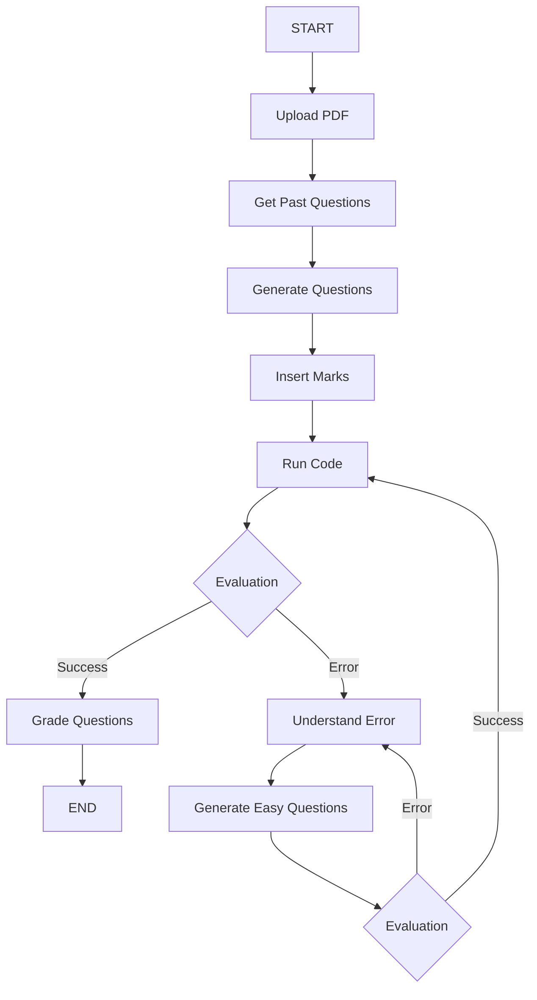

# adaptive-exam
Adaptive Examination
# Adaptive Learning Platform with LangGraph

## Aims

This project implements an intelligent adaptive learning system using LangGraph, a framework for building stateful, multi-actor applications with LLMs. The system creates a personalized learning experience by generating questions, evaluating student performance, and adapting the difficulty level based on student responses.

## Objectives

- **Personalized Learning**: Generate questions based on uploaded lecture materials
- **Adaptive Difficulty**: Adjust question complexity based on student performance
- **Error Analysis**: Provide detailed explanations when students make mistakes
- **Progress Tracking**: Monitor student progress through iterations
- **Intelligent Grading**: Automated assessment with detailed feedback

##  Architecture & Workflow

The system uses a state-driven workflow with the following components:




### Workflow Steps:

1. **Upload PDF**: Upload lecture notes and materials
2. **Get Past Questions**: Retrieve previous questions if available
3. **Generate Questions**: Create new questions using RAG and LLM
4. **Insert Marks**: Assign point values to questions
5. **Run Code**: Execute student code and evaluate
6. **Evaluation**: Determine success or error
7. **Grade Questions**: Provide detailed feedback for successful attempts
8. **Understand Error**: Analyze and explain errors using Gemini
9. **Generate Easy Questions**: Create simpler questions with hints for struggling students

##  Key Libraries & Dependencies

### Core Framework
- **LangGraph** (`langgraph==0.5.4`): State-driven workflow orchestration
- **LangChain** (`langchain==0.3.26`): LLM application framework
- **LangChain Core** (`langchain-core==0.3.70`): Core abstractions and interfaces

### LLM Integration
- **OpenAI** (`openai==1.97.0`): Primary LLM for question generation and evaluation
- **LangChain OpenAI** (`langchain-openai==0.3.28`): OpenAI integration for LangChain
- **Google Gemini**: Used for error analysis and concept explanation

### State Management
- **Pydantic** (`pydantic==2.11.7`): Data validation and settings management
- **TypedDict**: Type-safe state definitions
- **Memory Saver**: Persistent state management across sessions

### Development & Jupyter
- **Jupyter** (`ipykernel==6.30.0`, `jupyter_client==8.6.3`): Interactive development
- **IPython** (`ipython==9.4.0`): Enhanced Python shell

### Utilities
- **Requests** (`requests==2.32.4`): HTTP library for API calls
- **Python-dotenv** (`python-dotenv==1.1.1`): Environment variable management
- **Tiktoken** (`tiktoken==0.9.0`): Token counting for OpenAI models

##  State Management

The system uses a `TypedDict` state structure:

```python
class AgentState(TypedDict):
    question_upload: bool          # PDF upload status
    pdf_upload: bool              # Lecture notes upload status
    questions: str                # Generated questions
    evaluation: Literal['success','error']  # Current evaluation result
    errors: str                   # Error messages
    next_question: Annotated[bool,False]  # Flag for next question
    iteration: int                # Current iteration count
    max_iteration: int           # Maximum allowed iterations
```

## Hardware & Software Requirements

### Prerequisites
- Python 3.11+
- OpenAI API key
- Google Gemini API key (optional, for enhanced error analysis)

### Installation

1. Clone the repository:
```bash
git clone <repository-url>
cd assign1
```

2. Create and activate virtual environment:
```bash
python -m venv adaptive_learning
source adaptive_learning/bin/activate  # On Windows: adaptive_learning\Scripts\activate
```

3. Install dependencies:
```bash
pip install -r requirements.txt
```

4. Set up environment variables:
```bash
# Create .env file
echo "OPENAI_API_KEY=your_openai_api_key_here" > .env
echo "GEMINI_API_KEY=your_gemini_api_key_here" >> .env
```

5. Run the notebook:
```bash
jupyter notebook main.ipynb
```

##  Work Breakdown Structure

### 1. Content Upload
- Students upload lecture notes (PDF format)
- System processes and extracts key concepts
- Past questions are retrieved if available

### 2. Question Generation
- Uses RAG (Retrieval-Augmented Generation) to extract relevant context
- Generates questions based on lecture content
- Assigns appropriate point values to questions

### 3. Student Interaction
- Students attempt to solve generated questions
- System executes and evaluates student code
- Performance is assessed automatically

### 4. Adaptive Learning
- **Success Path**: Questions are graded with detailed feedback
- **Error Path**: System analyzes errors using Gemini
- **Difficulty Adjustment**: Easier questions with hints are generated for struggling students

### 5. Iterative Improvement
- System tracks iteration count
- Prevents infinite loops with maximum iteration limits
- Provides progressive learning experience

## Key Features

- **Intelligent Error Analysis**: Uses Gemini to break down complex concepts
- **Adaptive Difficulty**: Automatically adjusts question complexity
- **Detailed Feedback**: Provides comprehensive explanations for both correct and incorrect answers
- **Progress Tracking**: Monitors student progress through iterations
- **State Persistence**: Maintains context across sessions

##  Contributing

1. Fork the repository
2. Create a feature branch (`git checkout -b feature/amazing-feature`)
3. Commit your changes (`git commit -m 'Add amazing feature'`)
4. Push to the branch (`git push origin feature/amazing-feature`)
5. Open a Pull Request

##  License

This project is licensed under the FuseMachines License - see the LICENSE file for details.

#Problems:
1. **PDF Content Extraction Challenges**: Extracting key concepts from lecture notes in PDF format can be error-prone due to inconsistent formatting, embedded images, or scanned documents. This may lead to incomplete or inaccurate extraction of information.

2. **Quality and Relevance of Generated Questions**: The RAG-based question generation system may produce questions that are either too generic, irrelevant, or not well-aligned with the actual lecture content, affecting the learning experience.

3. **Automated Code Evaluation Limitations**: Automatically executing and evaluating student code submissions can pose security risks (e.g., code injection) and may not handle all edge cases or programming languages effectively.

4. **Adaptive Learning Complexity**: Implementing effective adaptive learning, including accurate error analysis and dynamic difficulty adjustment, requires sophisticated algorithms and reliable integration with models like Gemini, which may not always provide precise feedback.

5. **State Persistence and Progress Tracking**: Maintaining accurate state and progress across sessions, especially in distributed or multi-user environments, can be challenging and may lead to data inconsistency or loss if not handled properly.

6. **Scalability and Performance**: As the number of users and uploaded documents increases, the system may face performance bottlenecks in processing, question generation, and feedback delivery.

7. **Integration with External APIs**: Reliance on external services (e.g., Gemini, OpenAI) introduces dependencies that may result in downtime, API changes, or increased costs.

8. **User Privacy and Data Security**: Handling sensitive student data and uploaded documents requires robust security measures to ensure privacy and compliance with relevant regulations.
