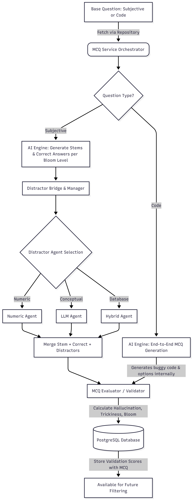
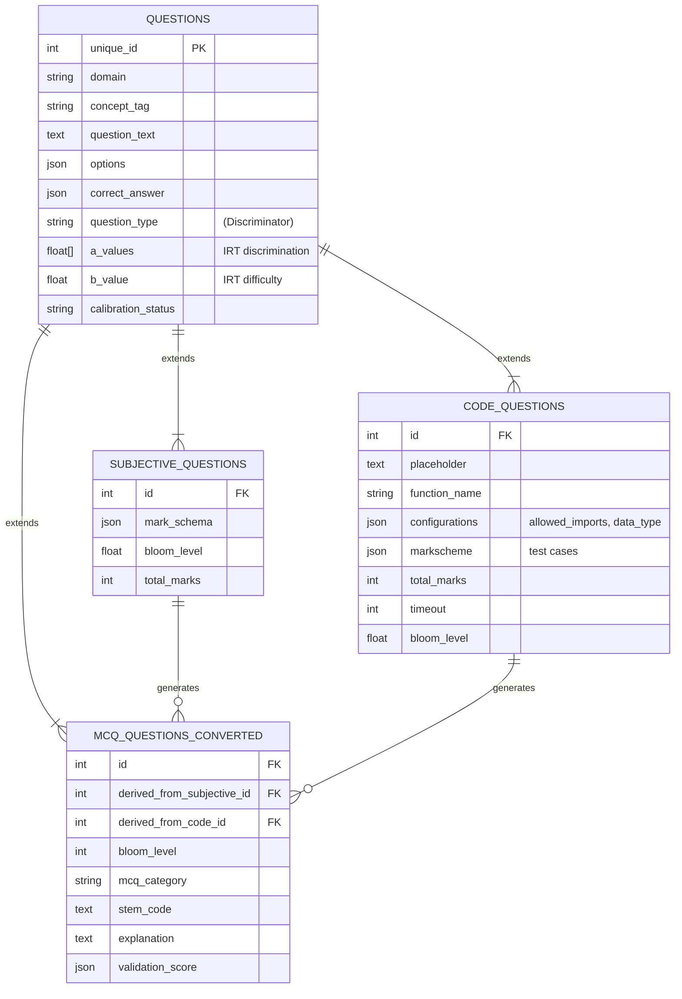

# 🚀 Adaptive Exam MCQ Generator: Product Demo & Technical Deep Dive

**Duration:** 15-20 Minutes  
**Audience:** Senior Engineers & Colleagues 
**Focus:** MCQ Generation Module, Architecture, Workflows, Validation, and Datastores

---

## 1️⃣ Introduction 

Welcome to the deep dive on the **MCQ Generator Module** for our Adaptive Exam platform. This module solves the problem of scaling question banks dynamically by leveraging generative AI to transform base subjective and code questions into high-quality, pedagogically sound multiple-choice questions (MCQs).

**Key Objectives of the Module:**
1. Automate generation of robust MCQs from existing subjective/coding problems.
2. Adhere to **Bloom's Taxonomy** for targeted difficulty and cognitive skills.
3. Automatically generate plausible **distractors** (wrong options).
4. Run an automated **LLM-as-a-Judge validation** step to guarantee quality.
5. Integrate seamlessly into our existing robust polymorphic PostgreSQL database schema.

---

## 2️⃣ System Architecture & Detailed Workflow

Here is a high-level view of how a question flows through our system.



### 🧠 How the MCQ Generator Works

The engine dynamically switches strategies depending on the base question source.

#### A. Subjective Questions to MCQs
1. **Fetch & Prompt:** The `MCQRepository` brings a `SubjectiveQuestion` to the `MCQEngine`. Gemini 2.5-flash is prompted to generate a unique question stem, correct answer, and an explanation.
2. **Per Bloom Level:** The engine is instructed to create exactly one MCQ core output tailored for each requested Bloom's Taxonomy level.
3. **Distractor Bridge:** Unlike code questions, subjective distractors are deferred to our isolated `DistractorManager`. This prevents the LLM from hallucinating "easy" random distractors and relies on targeted agent generation.

#### B. Code Questions to MCQs
1. **End-to-End Generation:** For a `CodeQuestion`, generating accurate buggy code requires full context. Therefore, the `MCQEngine` bypasses the `DistractorBridge` and generates the entire payload synchronously.
2. **Code MCQ Categories:** The system maps to specific interactive formats:
   - `code_fill_blank`: Skeleton `stem_code` with `???`
   - `code_find_bug`: Generates deliberate errors in the implementation.
   - `code_implementation`: Select the correct full piece of logic.

---

## 3️⃣ Distractor Generation Engine 

Plausible distractors are what make an MCQ great. We implemented a **3-Agent System** localized in `/distractor_generation`.

1. **NumericAgent:** Handles numbers, equations, and complexities (e.g., Big-O). It applies common off-by-one errors, doubling, halving, and fraction manipulation without needing LLM latency.
2. **LLMAgent (Groq + Llama-3.3-70b):** Given a concept tag, it uses a specialized prompt to generate common pedagogical misconceptions. Responses are checked for cosine similarity to ensure they aren't identical to the correct answer.
3. **HybridAgent:** Database-first strategy checking `distractor_db.json` for curated misconceptions. Falls back to LLM if there aren't enough entries. All selections pass through a deduplication check exactly yielding 3 distractors.

---

## 4️⃣ Implementation of Bloom's Taxonomy

Our adaptive exam strictly differentiates on cognitive loads. We implemented Bloom’s levels natively into the generative prompts and validation schema:

*   **Level 1 (Remember):** Tests basic definitions or rote recall.
*   **Level 2 (Understand):** Tests conceptual grasp and translation of concepts (e.g., what does this matrix operation fundamentally represent?).
*   **Level 3 (Apply):** Problem-solving in new scenarios (e.g., compute the result for $n = 64$).
*   **Level 4 (Analyze):** Critical reasoning, trade-offs, decomposition.

The `.bloom_level` dictates both the prompt directives pushed to Gemini as well as what the validator expects.

---

## 5️⃣ Validation Process for Generated MCQs

Every assembled MCQ is run through the `MCQEvaluator` (an LLM-as-a-judge system running Gemini at low temperature).

**Evaluation Metrics Calculated:**
1. **Hallucination Score (1-5):** Does the question contradict the core subject material or the mark scheme? 
2. **Trickiness Score (1-5):** Are the distractors convincingly challenging?
3. **Bloom Alignment (0 or 1):** Binary check. If the generated question targets "Remember" but we requested "Apply", it receives 0.

*Note on Data Persistence:* The MCQ and its validation scores are saved directly to the database. We do not enforce blocking thresholds during generation. Instead, the `validation_score` JSON allows the frontend/admin systems to independently filter, flag, or curate questions based on arbitrary quality thresholds before they are deployed to an exam session.

---

## 6️⃣ Database Schemas and Alembic Implementation

To support varying data shapes (code structures vs standard text stems) while tracking performance uniformly via IRT (Item Response Theory), we utilized a **Polymorphic Database Schema** on SQLAlchemy and PostgreSQL.



**Recent Alembic Migrations:**
*   `02ab4ea96324_initial_database_setup.py`: Defined the polymorphic relationships.
*   `123456789abc_add_mcq_category_and_stem_code.py`: Pushed schema changes to support frontend rendering maps (mapping category to React/Streamlit views).

---

## 7️⃣ 🚦 Live DB Examples: Analytical Deep Dive

We queried our active Docker PostgreSQL container (`adaptive_exam_db`) to pull real examples of independent AI generations for both conceptual and coding questions.

### 📝 Example A: Subjective to MCQ Transformation
*From `subjective_questions` (ID: 1)*

**Base subjective question:**  
> **Domain:** Linear Algebra / Transformations  
> **Question:** In the context of using CAD software to manipulate architectural blueprints, explain how a horizontal shear transformation, represented by the matrix $S_x = \begin{pmatrix} 1 & k \\ 0 & 1 \end{pmatrix}$ where $k$ is the shear factor, modifies the coordinates of a general vector $\mathbf{v} = \begin{pmatrix} x \\ y \end{pmatrix}$. Describe the specific change in the $x$-component relative to the $y$-component and how this fundamentally skews the shape in the horizontal direction.

**Generated Conceptual MCQs:**

1. **MCQ (ID 12) - Bloom Level 2 (Understand)**
   > **Stem:** A horizontal shear transformation is characterized by the matrix $S_x = \begin{pmatrix} 1 & k \\ 0 & 1 \end{pmatrix}$. When this transformation is applied to an arbitrary vector $\mathbf{v} = \begin{pmatrix} x \\ y \end{pmatrix}$, which statement accurately describes the resulting modification to its components?
   > **Options:**
   > - **A:** Both the x and y components of the vector are scaled by the shear factor k, resulting in a proportional increase in the vector's magnitude.
   > - **B:** The transformation results in a rotation of the vector by an angle determined by the shear factor k, rather than a shear.
   > - **✅ C (Correct):** The y-component of the vector remains unchanged, while the x-component is augmented by a value directly proportional to the original y-component, scaled by the shear factor k.
   > - **D:** A common misconception about Linear Algebra / Transformations

2. **MCQ (ID 13) - Bloom Level 3 (Apply)**
   > **Stem:** Consider a vertical line segment connecting the points $P_1(3, 2)$ and $P_2(3, 6)$. If a horizontal shear transformation with a shear factor $k=0.5$ is applied to this segment, what are the new coordinates of its endpoints, and what geometric characteristic best describes the transformed segment?
   > **Options:**
   > - **✅ A (Correct):** The endpoints transform to $(4, 2)$ and $(6, 6)$, resulting in a slanted line segment.
   > - **B:** The endpoints transform to (2, 2) and (4, 6), resulting in a slanted line segment, since the horizontal shear transformation with k=0.5 reduces the x-coordinate of the first point and increases the x-coordinate of the second point.
   > - **C:** The endpoints transform to (3.5, 2) and (3.5, 6), resulting in a vertical line segment, because the shear factor k=0.5 only shifts the line halfway.
   > - **D:** The endpoints transform to (3, 2) and (3, 6), resulting in a vertical line segment, as the horizontal shear transformation does not affect vertical lines.

---

### 💻 Example B: Code Question to Interactive MCQs
*From `code_questions` (ID: 28)*

**Base prompt structure:**  
> **Question:** Write a function `fibonacci(n)` that returns the nth Fibonacci number. The sequence starts with F(0) = 0 and F(1) = 1.  
> **Function:** `fibonacci`

The system automatically unrolled this into 4 interactive formats corresponding to distinct Bloom difficulties:

1. **MCQ (ID 53) - `code_fill_blank` (Level 1: Remember)**
   > **Stem:** Consider the recursive implementation of the Fibonacci sequence. Which code snippets correctly define the base cases for `fibonacci(n)`?
   > **Code Block:**  
   > ```python
   > def fibonacci(n):
   >     if n == 0:
   >         # Missing code for F(0)
   >         ???
   >     if n == 1:
   >         # Missing code for F(1)
   >         ???
   >     return fibonacci(n - 1) + fibonacci(n - 2)
   > ```
   > **Options:**
   > - **✅ A (Correct):** 
   >   ```python
   >   return 0
   >   if n == 1:
   >       return 1
   >   ```
   > - **B:**
   >   ```python
   >   return 1
   >   if n == 1:
   >       return 0
   >   ```
   > - **C:**
   >   ```python
   >   return n
   >   if n == 1:
   >       return n
   >   ```
   > - **D:**
   >   ```python
   >   return 0
   >   if n == 1:
   >       return 0
   >   ```

2. **MCQ (ID 54) - `code_fill_blank` (Level 2: Understand)**
   > **Stem:** In an iterative approach to calculate the nth Fibonacci number, we often use an array (or list) to store previously computed values. What is the correct way to update the array within the loop to calculate `fib[i]`?
   > **Code Block:** 
   > ```python
   > def fibonacci(n):
   >     if n <= 1:
   >         return n
   >     fib = [0] * (n + 1)
   >     fib[0] = 0
   >     fib[1] = 1
   >     for i in range(2, n + 1):
   >         # Missing code for fib[i]
   >         ???
   >     return fib[n]
   > ```
   > **Options:**
   > - **✅ A (Correct):** `fib[i] = fib[i - 1] + fib[i - 2]`
   > - **B:** `fib[i] = fib[i - 1] + fib[i]`
   > - **C:** `fib[i] = fib[i + 1] + fib[i + 2]`
   > - **D:** `fib[i] = i - 1 + i - 2`

3. **MCQ (ID 55) - `code_find_bug` (Level 3: Apply)**
   > **Stem:** The following Python function attempts to calculate the nth Fibonacci number... Identify the line that needs to be corrected to make the function work for all valid non-negative `n`.
   > **Code Block:** 
   > ```python
   > def fibonacci(n):
   >     if n == 0:
   >         return 0
   >     if n == 1:
   >         return 1
   >     
   >     a, b = 0, 1
   >     for _ in range(2, n): # Line to check
   >         a, b = b, a + b
   >     return b
   > ```
   > **Options:**
   > - **A:** `if n == 0:`
   > - **B:** `if n == 1:`
   > - **✅ C (Correct):** `for _ in range(2, n):`
   > - **D:** `a, b = b, a + b`

4. **MCQ (ID 52) - `code_implementation` (Level 4: Analyze)**
   > **Stem:** Which of the following Python implementations correctly and most efficiently calculates the nth Fibonacci number, given that `n` can be up to 10^5?
   > **Options:**
   > - **A:** 
   >   ```python
   >   def fibonacci(n):
   >       if n <= 1:
   >           return n
   >       return fibonacci(n - 1) + fibonacci(n - 2)
   >   ```
   > - **B:** 
   >   ```python
   >   def fibonacci(n):
   >       if n <= 1:
   >           return n
   >       dp = [0] * (n + 1)
   >       dp[0] = 0
   >       dp[1] = 1
   >       for i in range(2, n + 1):
   >           dp[i] = dp[i - 1] + dp[i - 2]
   >       return dp[n]
   >   ```
   > - **✅ C (Correct):**
   >   ```python
   >   def fibonacci(n):
   >       if n <= 1:
   >           return n
   >       a, b = 0, 1
   >       for _ in range(2, n + 1):
   >           a, b = b, a + b
   >       return b
   >   ```
   > - **D:**
   >   ```python
   >   def fibonacci(n, memo={}):
   >       if n in memo:
   >           return memo[n]
   >       if n <= 1:
   >           return n
   >       memo[n] = fibonacci(n - 1, memo) + fibonacci(n - 2, memo)
   >       return memo[n]
   >   ```

---

## 8️⃣ 🔍 Analysis Session: Comparison & Workflow Implications

Looking at the side-by-side generations from the database, we can observe key architectural wins:

| Feature | Subjective Pipeline (Example A) | Code Pipeline (Example B) |
| :--- | :--- | :--- |
| **Generation Strategy** | Fragmented (Core + Distractor Bridge) | Synchronous / End-to-end (Context dependent) |
| **Distractor Source** | External Agent Network (Numeric, LLM) | Internal LLM derivation (Logical Bugs) |
| **Frontend Mapping** | `mcq_category='text'` (Standard Radio Boxes) | `mcq_category='code_find_bug'`, etc. (Interactive Code Mirrors) |
| **Bloom Level Scaling** | Shifts conceptual depth (e.g. formula vs application) | Shifts required action (e.g. complete syntax vs analyze algorithm efficiency) |

**Conclusion:** 
The pipeline treats code natively rather than converting it to plain text, ensuring the output formats (`stem_code`) remain compiler-friendly and pedagogically aligned with how software engineering candidates are actually evaluated.

---

## 9️⃣ Summary & Next Steps
- We have fully automated the transition from subjective/code testing to scalable Item Response Theory (IRT) pools.
- **Future goals:** Integrating adaptive IRT parameters generation dynamically directly from our validation pipeline.

#### Q&A
*(Open room for questions)*