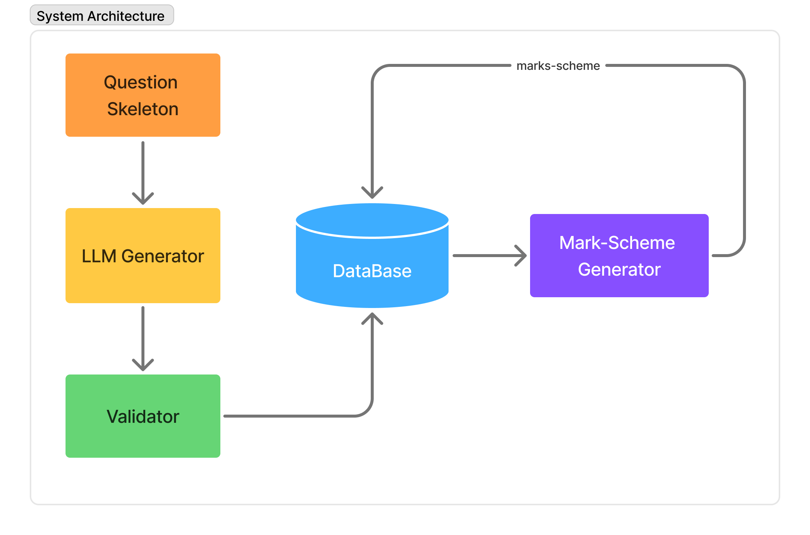
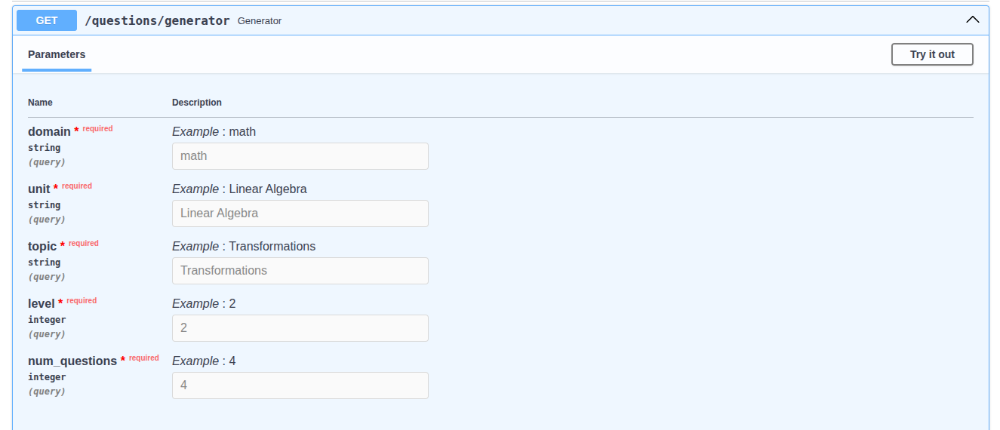

## Project Name: Question Generation System

### Overview:
The Question Generation System is designed to automatically generate assessment questions aligned with the curriculum of the Fusemachines AI Fellowship program. The system focuses on foundational domains relevant to Artificial Intelligence and Machine Learning, particularly Mathematics topics such as Linear Algebra, Calculus, and Probability and Statistics.

Question generation is guided by the first three cognitive levels of Bloom’s Taxonomy—Remember, Understand, and Apply. A structured question skeleton, containing the base question, Bloom level, context, and constraints, is provided as input to a Large Language Model (LLM) to generate well-formed questions.

The generated questions are validated using an LLM-as-Judge mechanism, where a validator agent evaluates them based on their alignment with the intended Bloom level and contextual relevance. Each question receives binary evaluation scores for Bloom alignment and context alignment.

Questions that pass validation are stored in a PostgreSQL database and are later retrieved by the Mark Scheme Generator module to produce corresponding marking schemes. This pipeline ensures that the generated questions are contextually accurate, pedagogically aligned, and suitable for automated assessment workflows.

### Objective:
The primary objective of the Question Generation System is to develop an automated pipeline that generates high-quality educational assessment questions aligned with the curriculum of the Fusemachines AI Fellowship program. The system aims to support structured learning and evaluation in foundational domains required for Artificial Intelligence and Machine Learning.

Specific objectives include:

Automate question generation using Large Language Models based on structured question skeletons containing base question, context, constraints, and cognitive level.

Ensure pedagogical alignment of generated questions with the first three cognitive levels of Bloom’s Taxonomy: Remember, Understand, and Apply.

Validate generated questions automatically using an LLM-as-Judge mechanism to evaluate Bloom level alignment and contextual relevance.

Maintain a reliable repository of validated questions by storing approved questions in a PostgreSQL database.

Support downstream assessment workflows by supplying validated questions to the mark-scheme generation module for automated marking scheme creation.

These objectives collectively ensure the development of a scalable system capable of producing pedagogically consistent and contextually accurate assessment questions.


### System Architecture


### Project Structure
```
generator
└── question_gen_system 
    ├── README.md
    ├── routes
    │   └── routes.py                   # API endpoints
    ├── src
    │   ├── agents
    │   │   ├── prompt_registry.py      # prompts
    │   │   └── question_agent.py       # question generator agent
    │   ├── core
    │   │   ├── generator.py            # question skeleton generator
    │   │   └── taxonomy_loader.py      # empty
    │   ├── crud.py                     # save questions into database
    │   ├── ingestion
    │   │   └── schema_loader.py        # schema loader
    │   ├── pipeline
    │   │   ├── batch_buffer.py         # buffer creater
    │   │  
    │   │       
    │   ├── schemas
    │   │   ├── items_schema.py         # pydantic schema for the generated questions
    │   └── services
    │       ├── processer.py            # data processor to ensure before validation
    │       └── validator.py            # question validator
    ├── taxonomy    
    │   └── schema.py                   # structured syllabus schema(topics, context)
    ├── tests                           # empty
    └── utils                           # empty
```

### API Documentation

Endpoint:
`GET /questions/generator` <br>
**Description**: Generates questions based on the specfied domain, unit, topic and Bloom's taxonomy level. You cannot randomly input any values into the parameters. First, you have to look into `taxonomy/schema.py` from there you can choose the domain, unit, topic and bloom's taxonomy(1 or 2 or 3). <br>
`num_questions`: you can choose integer number to generate 'n' number of questions.




```
"generated_questions": [
      {
        "question_id": "9cb42a20-5ed2-4ba6-b806-7d4574fee7af",
        "domain": "math",
        "unit": "Linear Algebra",
        "topic": "Transformations",
        "context": "Applying geometric transformations to 2D objects in computer graphics.",
        "bloom_level": 2,
        "question": "Consider a 2D vector $\\mathbf{v} = \\begin{pmatrix} x \\\\ y \\end{pmatrix}$. Explain how a linear transformation $L: \\mathbb{R}^2 \\to \\mathbb{R}^2$, represented by a $2 \\times 2$ matrix $A$, modifies the components of $\\mathbf{v}$ to produce a new vector $\\mathbf{v}' = A\\mathbf{v}$. Elaborate on how linear transformations inherently preserve the origin and the straightness of lines, thus maintaining certain fundamental geometric structures while generally altering distances and angles.",
        "bloom_score": null,
        "context_score": null,
        "reason": null,
        "total_marks": null
      }
    ]
```


